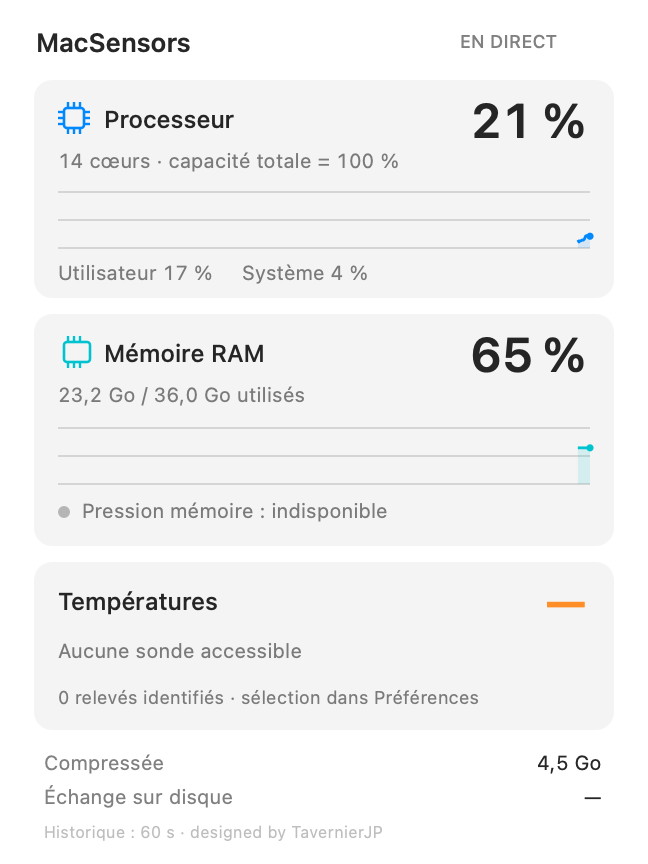
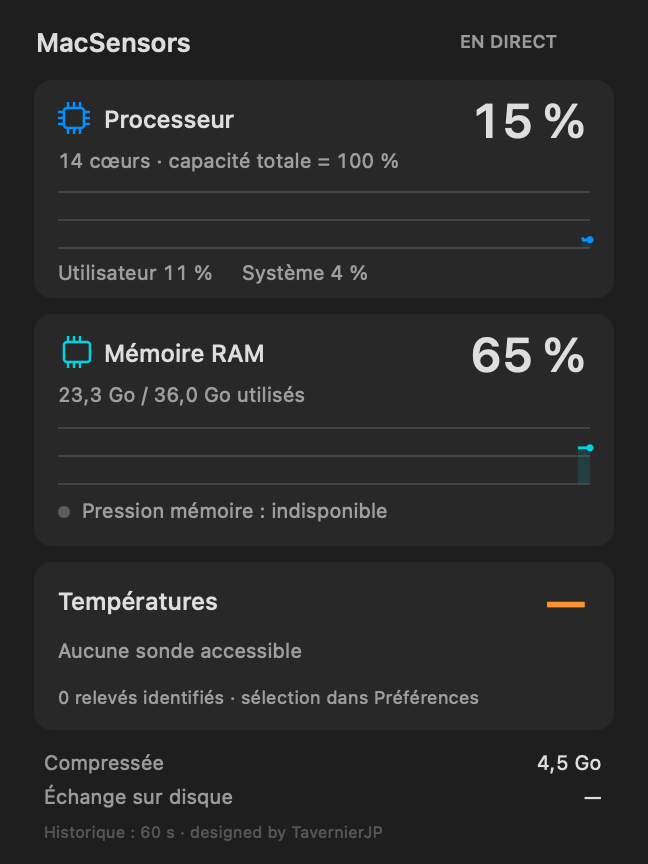

# MacSensors 1.2

[English](README.md) · [Télécharger la version 1.2](https://github.com/tavernierjipi-ship-it/MacSensors/releases/tag/v1.2) · [Signaler un problème](https://github.com/tavernierjipi-ship-it/MacSensors/issues/new/choose)

**designed by TavernierJP**

Une application native macOS pour afficher l’utilisation du CPU, de la RAM et les températures choisies dans la barre de menus. Elle remplace le prototype CPU & RAM ; ses sources complètes accompagnent l’application.

Version communautaire expérimentale pour les Mac Apple Silicon sous macOS 13 ou ultérieur. L’interface est en français. Les correspondances thermiques de la version 1.2 restent à valider sur davantage de machines physiques ; voir [VALIDATION.md](VALIDATION.md).

| Mode clair | Mode sombre |
| --- | --- |
|  |  |

Ces aperçus sont des rendus de l’interface réelle, produits dans un environnement sans accès aux sondes. Aucune température fictive n’est affichée.

## Installation

1. Décompresser `MacSensors-1.2-AppleSilicon.zip` et ouvrir le dossier `MacSensors-1.2`.
2. Glisser `MacSensors.app` dans le raccourci `Applications`.
3. Quitter l’ancien outil CPU & RAM et, si vous souhaitez le remplacer, l’outil Température processeur de Parallels Toolbox. Désactiver aussi leur démarrage automatique s’il était activé.
4. Ouvrir MacSensors depuis Applications. Un élément CPU / RAM / température apparaît dans la barre de menus.

L’application est déjà compilée pour Apple Silicon : Xcode et Python ne sont pas nécessaires pour l’utiliser. Elle porte une signature technique locale ad hoc, sans certificat Developer ID ni notarisation Apple. Si macOS bloque le premier lancement après téléchargement, tenter de l’ouvrir une fois, puis utiliser Réglages Système → Confidentialité et sécurité → Ouvrir quand même et confirmer. Vérifier les sources et l’empreinte SHA-256 de la release avant de l’approuver.

## Choisir les températures

Cliquer sur MacSensors dans la barre de menus, puis ouvrir **Préférences → Températures dans la barre de menus**.

- **Automatique · CPU en priorité** choisit le relevé CPU TCMb lorsqu’il est disponible, puis une autre mesure CPU/puce identifiée. Il ne choisit jamais une clé SMC brute non identifiée.
- Les groupes **Synthèses**, **Processeur**, **Processeur graphique**, **Batterie**, **Stockage**, **Puce et alimentation** et **Autres relevés** apparaissent en fonction des sondes réellement détectées.
- Cocher une ou plusieurs températures pour les afficher ensemble. Décocher une température pour la retirer ; **Masquer les températures** retire tous les relevés thermiques de la barre de menus.
- **Toutes les températures** permet de consulter les relevés détectés sans les afficher tous en permanence.
- **Rechercher les sondes à nouveau** relance la détection. Les réglages permettent également de choisir °C ou °F, CPU/RAM visibles ou masqués, RAM en % ou en Go et affichage normal ou compact.

Les choix sont conservés entre les lancements. Si une sonde sélectionnée disparaît ou ne renvoie pas de valeur exploitable, elle affiche « — ».

## Mesures et nomenclature

- CPU : capacité globale de tous les cœurs, de 0 à 100 %, avec environ une seconde d’initialisation.
- RAM : mémoire physique des applications, mémoire câblée et compressée, cache récupérable exclu. 1 Go affiché = 1 024³ octets.
- Températures : accès en lecture seule au SMC et, lorsque disponible, aux services HID de température de macOS.
- La sélection automatique privilégie les relevés CPU centraux TCMb puis TCMz lorsqu’ils sont disponibles. Sur M3, les familles Tp/Te et Tg sont présentées comme des zones CPU/GPU, sans correspondance affirmée avec chaque cœur physique. Les anciennes associations CPU/GPU de la famille Tf sont retirées car les sources communautaires se contredisent. Les synthèses restent des calculs sur les relevés identifiés disponibles.
- Les relevés SMC non identifiés sont masqués par défaut. Pour les consulter : Préférences → Afficher les relevés SMC non identifiés (avancé). Ils sont marqués « brut », sans unité °C et sans conversion en Fahrenheit ; leur signification physique n’est pas confirmée. Certaines clés peuvent être des paramètres, des constantes ou des mesures dérivées.
- Les valeurs nulles, négatives, non finies et hors plage exploitable sont écartées. Certains domaines CPU/GPU en veille ne fournissent temporairement aucune valeur.
- L’accès aux températures utilise des interfaces matérielles partiellement documentées et peut dépendre du modèle, du firmware et de macOS. En cas d’accès refusé, CPU et RAM continuent de fonctionner.

## Ressources

Un seul processus ; aucune commande externe ni application Parallels n’est lancée pour mesurer les températures. Les connexions aux capteurs, leurs métadonnées et leur liste sont réutilisées. La détection complète n’est pas refaite à chaque mesure.

CPU et RAM sont actualisés toutes les 1, 2 ou 5 secondes selon le réglage. Les températures sont lues au plus toutes les 2 secondes, ou à la cadence de 5 secondes si celle-ci est choisie. Lorsque le menu est fermé, seuls les capteurs sélectionnés et ceux nécessaires à leurs synthèses sont relus. Les clés brutes cachées ne sont pas relues à chaque ouverture du menu normal. Le menu ouvert rafraîchit aussi les autres relevés. Les mises à jour sont suspendues pendant la veille du Mac.

Si aucune température n’est sélectionnée, les lectures thermiques périodiques sont arrêtées hors consultation du menu. En cas d’absence totale de capteurs accessibles, une nouvelle détection est limitée à une fois par minute, ou demandée manuellement.

## À propos et ouverture à la connexion

**À propos de MacSensors** ouvre une fenêtre avec l’icône, le nom MacSensors, la mention exacte **designed by TavernierJP**, la version et la date de publication. Cette mention de présentation est distincte du certificat de signature technique.

L’ouverture à la connexion est facultative et désactivée par défaut. Installer l’application dans Applications avant de l’activer.

## Désinstallation

Désactiver l’ouverture à la connexion si elle était activée, quitter MacSensors et supprimer `MacSensors.app`.

## Correction 1.2

La détection de la version 1.1 était trop permissive : une clé SMC commençant par T et contenant un nombre plausible ne prouve pas une température physique. La version 1.2 corrige les libellés, la sélection automatique et la séparation des relevés bruts. Une ancienne sélection brute est conservée mais explicitement marquée « brut » ; choisir Automatique pour revenir au relevé CPU recommandé.

## Licence et contributions

Le projet est publié sous [licence MIT](LICENSE), Copyright © 2026 TavernierJP. Il a été développé avec une assistance IA ; TavernierJP porte le projet et le crédit de conception. Les contributions en français ou en anglais sont bienvenues : voir [CONTRIBUTING.md](CONTRIBUTING.md) et [CHANGELOG.md](CHANGELOG.md).
