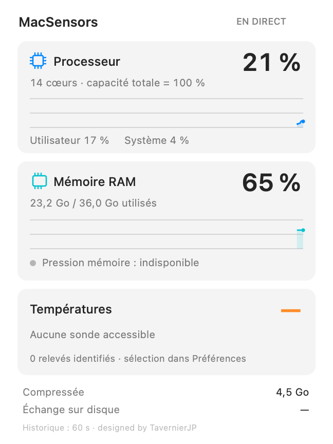
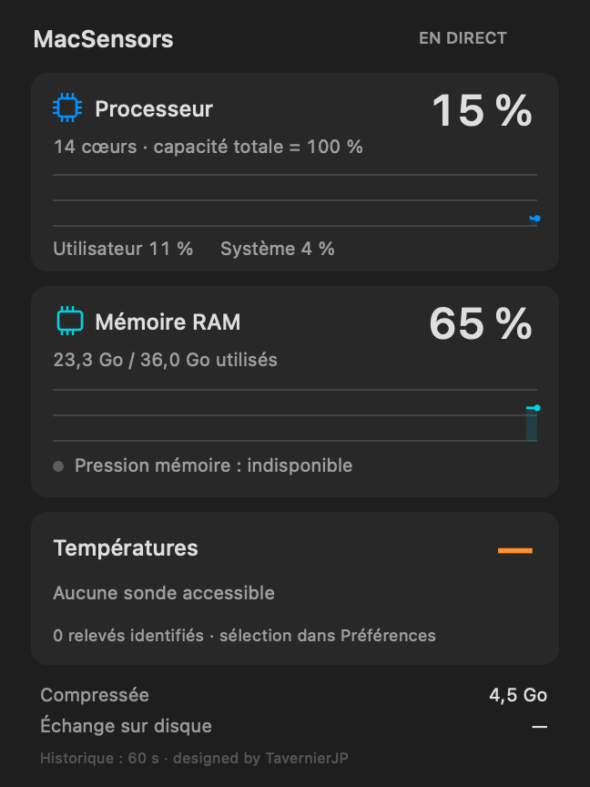

# MacSensors

**designed by TavernierJP** · [Français](README.fr.md)

A native macOS menu bar app that displays CPU usage, RAM usage and your choice of temperature readings in one place. Written in Swift/AppKit with a small, read-only C bridge to macOS hardware interfaces. No third-party runtime dependencies.

[Download v1.2](https://github.com/tavernierjipi-ship-it/MacSensors/releases/tag/v1.2) · [Report a bug](https://github.com/tavernierjipi-ship-it/MacSensors/issues/new/choose) · [Contribute](CONTRIBUTING.md)

## Preview

| Light | Dark |
| --- | --- |
|  |  |

These are offscreen renders of the real interface. The rendering environment cannot access temperature sensors, so the previews show their unavailable state. They do not contain simulated temperature readings. The app interface is currently in French.

## Features

- CPU usage across all cores, on a 0–100% scale.
- RAM usage in percent or GiB, with a detailed breakdown and recent history.
- Select one or several available temperature readings, use automatic CPU selection, or hide temperatures.
- Celsius/Fahrenheit, compact display, configurable 1/2/5 second update interval and optional launch at login.
- A single process, cached sensor discovery, background thermal reads and suspension during sleep.
- No telemetry, account, network service, administrator helper or fan control.

## Requirements and status

- Apple Silicon Mac (arm64), macOS 13 or later. Intel builds are not provided.
- Version 1.2 is an **experimental community release**. Build, measurement and selection tests pass; the new temperature mapping still needs testing on more physical Macs. See [validation and limitations](VALIDATION.md).
- Temperature access uses partially documented SMC/HID interfaces. Available readings depend on hardware, firmware and macOS. CPU/RAM remain available when temperature access is denied.
- The number of software readings is not the number of physical temperature probes. Unknown SMC keys are hidden by default, marked **raw** in advanced mode, and never automatically treated as degrees Celsius.

## Install

1. Download `MacSensors-1.2-AppleSilicon.zip` from the [v1.2 release](https://github.com/tavernierjipi-ship-it/MacSensors/releases/tag/v1.2).
2. Unzip it and drag `MacSensors.app` to the `Applications` shortcut.
3. Open the app. Click its CPU/RAM/temperature item in the menu bar to see readings and preferences.

Xcode and Python are not needed to use the compiled app. The distributed app is ad hoc signed, without an Apple Developer ID certificate or notarization. macOS may require approval in **System Settings → Privacy & Security → Open Anyway** after the first attempted launch. Check the release source and checksum before approving it.

To uninstall, disable launch at login if enabled, quit MacSensors, and remove the app.

## Select temperatures

Open **Préférences → Températures dans la barre de menus**. Choose **Automatique · CPU en priorité**, check specific readings, or select **Masquer les températures**. Choices are saved between launches. Missing readings display `—`.

Automatic mode prefers the identified CPU reading `TCMb`, then `TCMz`, then available CPU/SoC/GPU summaries. It never selects an unidentified raw channel. On M3, `Tp`/`Te` and `Tg` families describe CPU/GPU zones, without claiming a one-to-one mapping to physical cores. Conflicting community descriptions of `Tf` keys are deliberately left unclassified.

**Afficher les relevés SMC non identifiés (avancé)** reveals raw channels for investigation. They have no confirmed temperature unit, are not converted to Fahrenheit and are excluded from summaries. Values such as `1` or a plausible `91.1` do not establish that a key is a physical temperature sensor.

## Build from source

Install Apple's Command Line Tools (`xcode-select --install`) and Python 3. A full Xcode installation is also supported. Build on an Apple Silicon Mac with the macOS SDK available through `xcrun`:

```sh
git clone https://github.com/tavernierjipi-ship-it/MacSensors.git
cd MacSensors
python3 scripts/build.py
python3 scripts/test.py
python3 scripts/package.py
```

The app is created in `.build/MacSensors.app`; distribution archives are written to `dist/`. No dependencies are downloaded by these scripts. Packaging includes the complete source, license and documentation. `python3 scripts/package.py --dmg` additionally requests a DMG from the host's disk image service.

Diagnostics use the same readers as the app:

```sh
.build/MacSensors.app/Contents/MacOS/MacSensors --sample
.build/MacSensors.app/Contents/MacOS/MacSensors --sensors
```

To render previews without opening a menu bar session:

```sh
.build/MacSensors.app/Contents/MacOS/MacSensors --preview .build/preview-light.png
.build/MacSensors.app/Contents/MacOS/MacSensors --preview .build/preview-dark.png --dark
.build/MacSensors.app/Contents/MacOS/MacSensors --preview .build/about-light.png --about
.build/MacSensors.app/Contents/MacOS/MacSensors --preview .build/about-dark.png --about --dark
```

GitHub Actions builds, runs the tests and packages the app on an Apple Silicon macOS runner. CI cannot validate physical temperature probes in a virtual machine.

## Source layout

| Path | Purpose |
| --- | --- |
| `Sources/main.swift` | Menu bar app, preferences and command-line diagnostics |
| `Sources/Metrics.swift` | CPU and memory sampling/calculation |
| `Sources/Temperatures.swift` | Sensor catalog, filtering, summaries and selection |
| `Sources/SensorsBridge.c` / `.h` | Read-only SMC and HID bridge |
| `Sources/Dashboard.swift` | Measurement panel and rendering |
| `Sources/About.swift` | About window and design credit |
| `Tests/main.swift` | Measurement, decoding and selection checks |
| `scripts/` | Build, icon generation, test and packaging tools |

## Contribute and license

Bug reports, translations and carefully documented hardware mappings are welcome. Read [CONTRIBUTING.md](CONTRIBUTING.md), [CHANGELOG.md](CHANGELOG.md) and [technical references](REFERENCES.md).

Released under the [MIT License](LICENSE). Copyright © 2026 TavernierJP. The app was developed with AI assistance; TavernierJP is the project owner and design credit. The repository contains its own implementation, without bundled code or resources from Parallels Toolbox.
